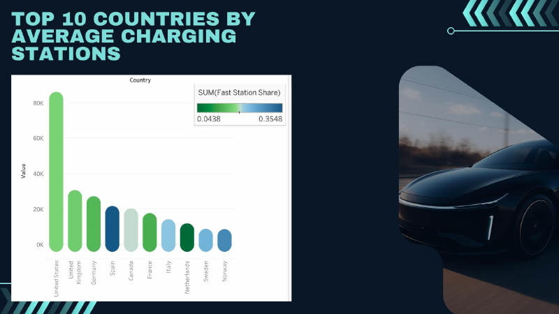
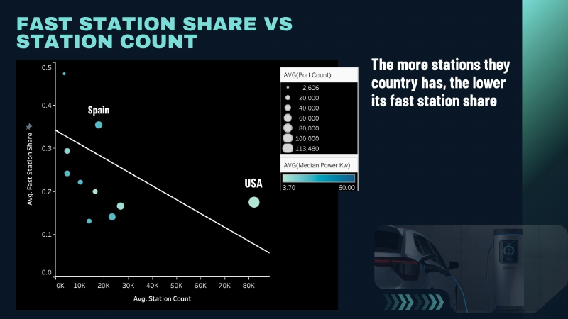
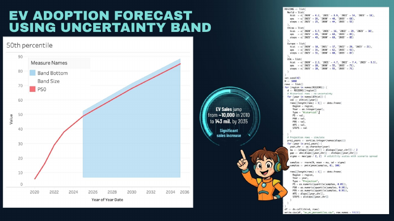

# EV Infrastructure Dashboard (team DATAlicious)

**Question:** Are electric vehicles as promising as they seem?

A team infographic and presentation on the global EV ecosystem: charging station counts, fast-charger share, infrastructure stress by country, and an adoption forecast with an uncertainty band.

Full resolution: [`assets/datalicious_infographic.jpg`](assets/datalicious_infographic.jpg) · Deck: [`ev_presentation.pdf`](ev_presentation.pdf)

## Findings shown
- The US has the most charging stations (about 82k), well ahead of the UK and Germany.
- Countries with more stations tend to have a lower share of fast chargers.
- Korea, Norway and Sweden rank highest on a weighted infrastructure stress index.
- The forecast chart plots median (P50) adoption with a 5th to 95th percentile band.

| | |
|---|---|
|  |  |
|  | |

## Method
- Charts built in **Tableau**.
- Forecast band produced by [`src/ev_monte_carlo_forecast.R`](src/ev_monte_carlo_forecast.R): 5,000 normal draws per region and year around the mean of the APS and STEPS scenarios, with spread scaled by the gap between them, clipped to 0-100.

## My role
_Add 1-2 lines on exactly what you did (for example: Tableau charts, R simulation, infographic layout)._

## Data
_Add the dataset source and link here._
