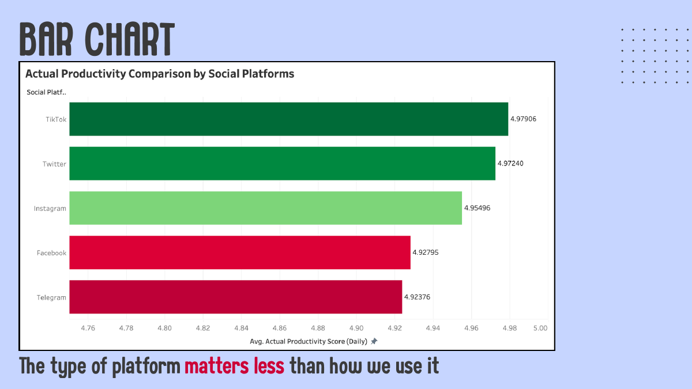
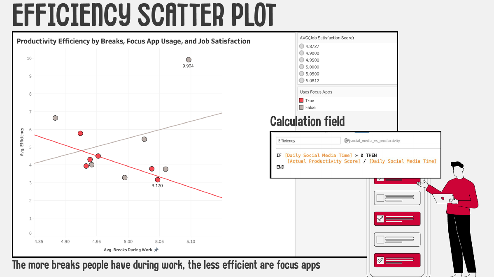

# Social Media vs Productivity

Tableau analysis of whether social media is really the problem for productivity.

**Data:** [Social Media vs Productivity (Kaggle, 30,000 simulated user records)](https://www.kaggle.com/datasets/mahdimashayekhi/social-media-vs-productivity)

Deck: [`social_media_vs_productivity.pdf`](social_media_vs_productivity.pdf)

| | |
|---|---|
|  |  |

## What the charts show
1. **Scatter plot:** people tend to overestimate how productive they are (perceived score sits above actual score).
2. **Bar chart:** differences between platforms are small, so the type of platform matters less than how it is used.
3. **Heatmap:** sleep duration and stress level interact in their effect on productivity.
4. **Efficiency scatter:** a calculated field (`Actual Productivity Score / Daily Social Media Time`) compared with breaks and focus-app use.

## Caveat
The dataset is simulated, so these are patterns in synthetic data, not causal claims.

## My role
_Add what you personally built._
