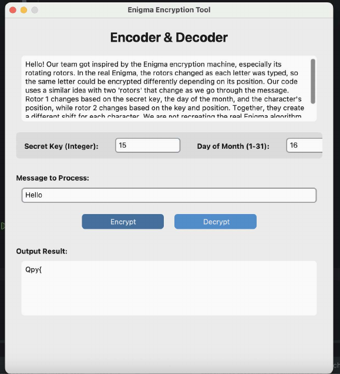
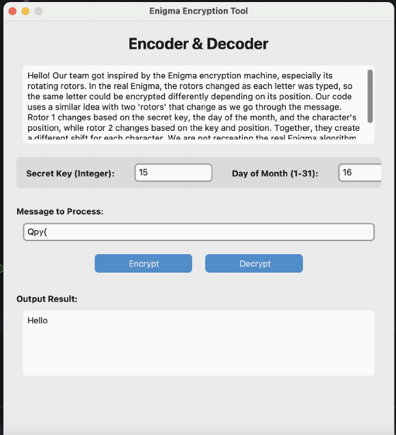

# Enigma-inspired Encryption Tool

A desktop encoder/decoder inspired by the Enigma machine's rotating rotors: the same letter encrypts differently depending on its position.

| Encrypt | Decrypt |
|---|---|
|  |  |

## How it works
For each character at index `position`:
```
rotor1 = (key + day_of_month + position) % 26
rotor2 = (key * 2 + position) % 26
shift  = rotor1 + rotor2
encrypt: chr(ord(c) + shift)     decrypt: chr(ord(c) - shift)
```
Decryption needs the same key **and** day of month. This is a learning project, **not secure encryption**. Output can include non-printable characters.

## Run
```bash
pip install customtkinter
python enigma_tool.py
python test_enigma.py      # round-trip tests
```

## Build a standalone app
```bash
pip install pyinstaller
python -m PyInstaller --onefile --windowed enigma_tool.py
```
Publish the built `.app` / `.exe` under GitHub **Releases** rather than committing it.
