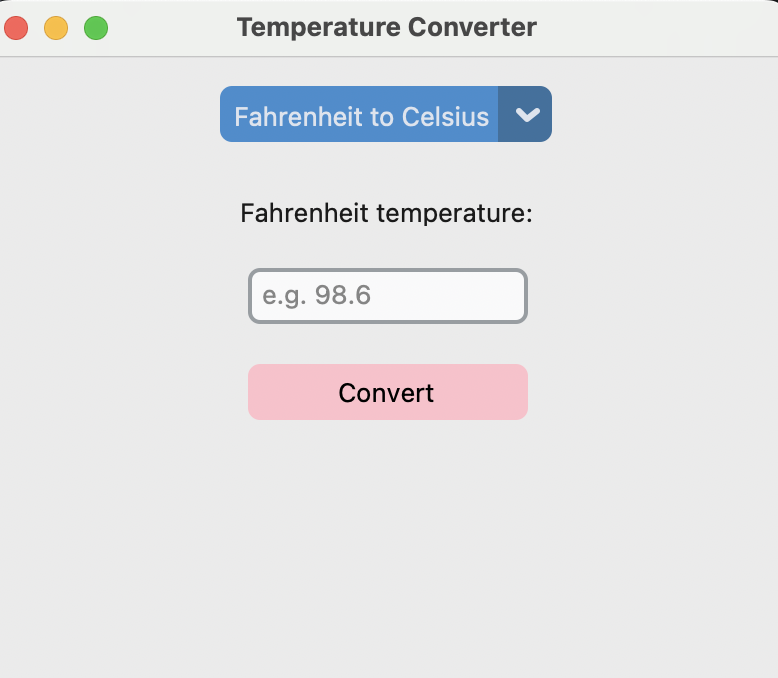
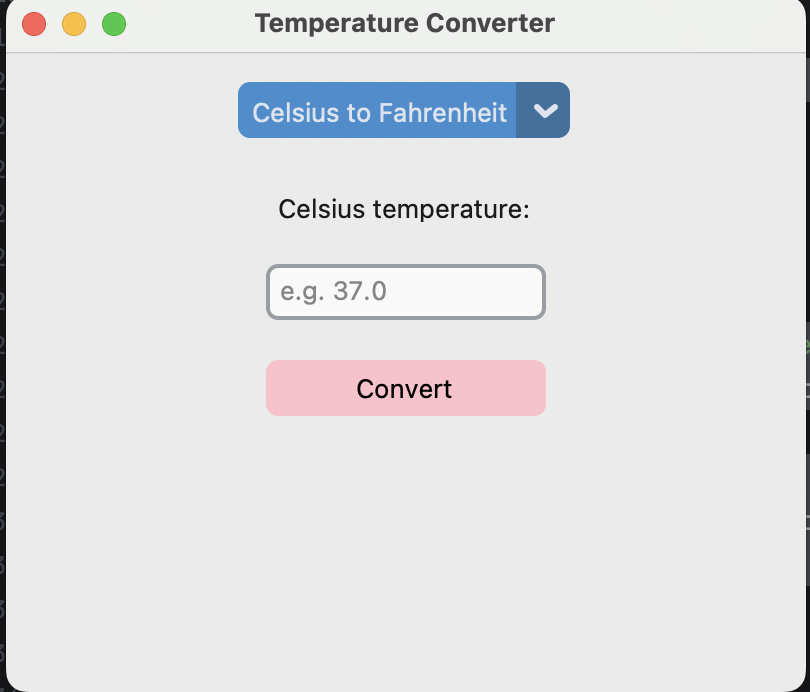

# Python GUI and Logic Exercises

Small programs from coursework. Each was planned as pseudocode (shown in the docstring) before coding.

## GUI (CustomTkinter)
| File | What it does |
|---|---|
| [`gui/temperature_converter.py`](gui/temperature_converter.py) | Fahrenheit <-> Celsius with a mode switch, input validation and dynamic labels |
| [`gui/catch_me_button.py`](gui/catch_me_button.py) | A button that dodges the cursor and gives up after 10 escapes |
| [`gui/click_counter_button.py`](gui/click_counter_button.py) | Earlier version: moves on click, stops after 5 |

 

## Logic and data handling
| File | Concepts |
|---|---|
| [`logic/credit_fraud_check.py`](logic/credit_fraud_check.py) | Branching rules, input validation, exceptions |
| [`logic/bonus_calculator.py`](logic/bonus_calculator.py) | if/elif tiers |
| [`logic/login_attempts.py`](logic/login_attempts.py) | while loop, accumulator, try/except |
| [`logic/triangle_calculator.py`](logic/triangle_calculator.py) | Nested functions, default and keyword-only arguments |
| [`logic/message_fixer.py`](logic/message_fixer.py) | String and list slicing |
| [`logic/email_generator.py`](logic/email_generator.py) | File I/O with `pathlib` and `shutil` |

```bash
pip install customtkinter
python gui/temperature_converter.py
```
