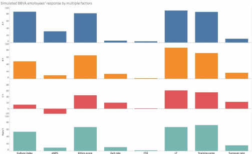
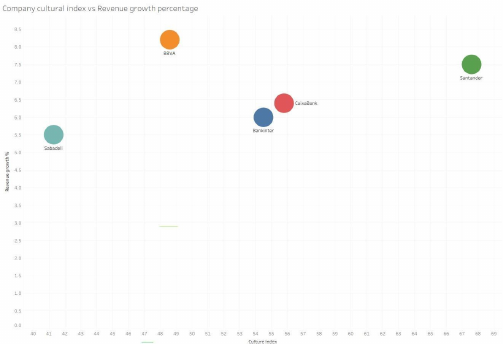
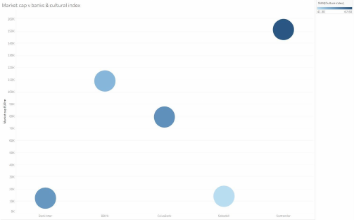

# Corporate Culture in Banking: A Culture Index for BBVA

A quantitative framework that turns BBVA's three corporate values (*Customer Comes First*, *We Think Big*, *We Are One Team*) into a measurable **Corporate Culture Index (CCI)**, built for BBVA Talent & Culture as a client project at the **IE University EconData Lab**.

**Report:** [`corporate_culture_report.pdf`](corporate_culture_report.pdf) (36 pages) · **Workbook:** [`bbva_culture_index_workbook.xlsx`](bbva_culture_index_workbook.xlsx)

## The problem
Culture is intangible, and satisfaction scores alone are not culture. BBVA had scattered signals (engagement surveys, eNPS, turnover, ESG ratings) but no single validated index tied to its stated values.

## Approach
- **Two-layer design.** An *Internal Culture Index* (Ethics, Satisfaction, Engagement, Employee Experience, Innovation) is built only from employee and organisational indicators. Customer and reputation outcomes sit in a separate *External Validation Layer*, which avoids circular validation.
- **Index construction.** Min-max standardisation against peer benchmarks, reverse coding for "bad" indicators, weighted aggregation scaled 0-100. Weights are treated as pilot assumptions and stress-tested (equal, PCA, CFA and expert weights).
- **No internal data.** BBVA data was not available, so the pipeline combines a Culture Perception Survey instrument, public benchmarks (Refinitiv/LSEG ESG data, Statista Brand KPIs) and a **synthetic employee panel** replicated under three culture scenarios (Strong, Average, Weak).
- **Five econometric models.** Retention (logit), satisfaction (fixed effects), ideas (Poisson / negative binomial), bank-level performance, and regional variation (ICC).

## Results (pilot)

| Scenario | Culture Index | Exit rate |
|---|---|---|
| Strong | 85.4 | 5.2% |
| Average | 47.9 | 13.7% |
| Weak | 13.4 | 20.4% |

The index and every indicator respond in the expected direction when the culture regime changes, which validates the machinery.

| | |
|---|---|
|  |  |

## Important: what the numbers mean
Index values and model results come from **simulated data** and demonstrate that the methodology works. They are **not** measurements of BBVA's actual culture. Only the Refinitiv and Statista figures are observed public data. The report states this limitation throughout.

## The workbook
`bbva_culture_index_workbook.xlsx` has about 3,800 employee-year rows and roughly 31,000 live formulas. Benchmark bounds and weights are editable, so changing one weight cell recalculates every index (reproducible generation, NumPy seed 42). Sheets: `README`, `codebook`, `employee_year`, `scaling_params`, `dept_year`, `bank_year`, `scenario_summary`, `lseg_observed`.

## Tools
Excel (live formulas), Python (data generation), R (CFA, planned), Tableau (figures), Refinitiv LSEG Workspace, Statista.

## My role
_Add 1-2 lines on your part: for example, group coordination, econometric analysis, index construction or the Tableau figures._

## Data sources
Refinitiv (LSEG) Public Companies dataset, accessed via LSEG Workspace (2026); Statista Brand KPIs (study 190428, 2024). The raw LSEG extraction is not redistributed here because of data licensing.
