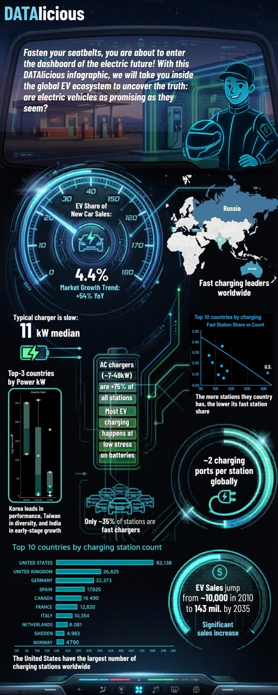

# Anna Kazachkova | Data & Python Portfolio

Data analytics, visualisation and Python projects from my Business Analytics studies. Each folder is a self-contained project with its own README.

**Contact:** [LinkedIn](https://www.linkedin.com/in/YOUR-HANDLE) · [Email](mailto:YOUR-EMAIL)

## Skills shown here

| Area | Tools |
|---|---|
| Data visualisation and storytelling | Tableau, infographic design, slide decks |
| Data analysis and ML | Python (pandas, NumPy, scikit-learn, matplotlib, seaborn), PCA, K-Means |
| Simulation and forecasting | R, Monte Carlo uncertainty bands |
| Software | Python, CustomTkinter GUIs, packaging with PyInstaller, pseudocode-first design |
| Teamwork | Group projects delivered as team **DATAlicious** |

## Projects

| # | Project | What it is | Stack |
|---|---|---|---|
| 1 | [**EV Infrastructure Dashboard**](01-ev-infrastructure-dashboard) | Team infographic and deck asking "are electric vehicles as promising as they seem?" | Tableau, R |
| 2 | [**Social Media vs Productivity**](02-social-media-vs-productivity) | Tableau analysis of 30,000 users: perceived vs actual productivity | Tableau |
| 3 | [**Global Development Clustering**](03-global-development-clustering) | PCA + K-Means on UN country data, tested against Rosling's *Factfulness* | Python, scikit-learn |
| 4 | [**Enigma-inspired Encryption Tool**](04-enigma-encryption-tool) | Desktop encoder/decoder with a two-rotor shift cipher | Python, CustomTkinter |
| 5 | [**Python GUI and Logic Exercises**](05-python-gui-and-logic-exercises) | Small apps and algorithms, each written as pseudocode first | Python |

  

## Notes

- Datasets are not redistributed. Each project README links to its source.
- Code is released under the MIT License.
